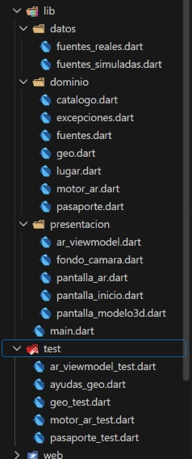
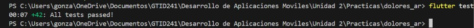
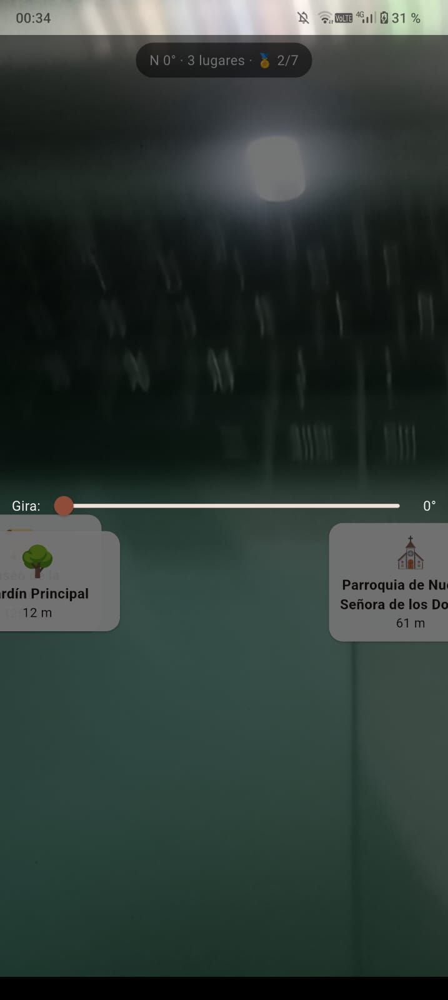
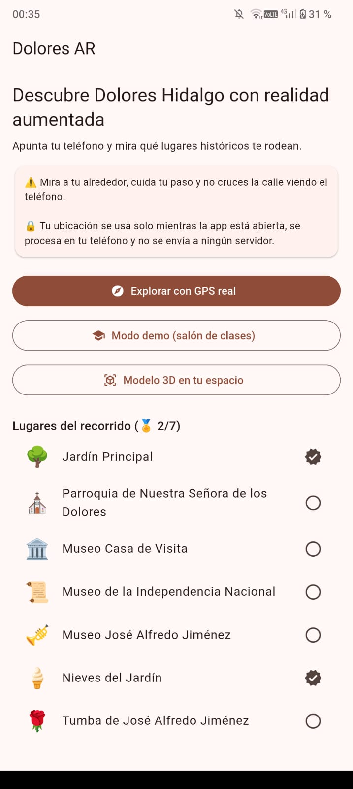

# Dolores AR · Realidad aumentada en Flutter con TDD

**Materia:** Desarrollo de Aplicaciones Móviles
**Alumno:** González López Yael Isaac
**Fecha:** 6 de noviembre de 2026

## Descripción

App turística de realidad aumentada para Dolores Hidalgo. Con GPS, brújula y cámara calcula dónde estás y hacia dónde miras, y dibuja etiquetas flotando sobre los lugares (Parroquia, Museo de la Independencia, Nieves del Jardín, etc.) con su distancia. Al acercarte a menos de 40 m de un lugar ganas un sello en tu pasaporte turístico, y también puedes ver un modelo 3D sobre el piso. Toda la matemática (distancias con Haversine, rumbos, ángulos, campo de visión y suavizado de la brújula) se desarrolló con TDD, y tiene un modo demo para probarla en el salón sin estar en Dolores.

## Estructura del proyecto

## Pruebas de casos (éxito y fallo)

## Pruebas de geometría (20) · test/geo_test.dart

Pruebas: distancia con Haversine (4), rumbo en grados (5), manejo de ángulos y cruce del 0°/360° (5), posición horizontal en el campo de visión (5) y formato de distancia (1).

### Éxito (todas en verde)

### Fallo (un grado de latitud mide unos 111.2 km)

## Pruebas del motor AR (9) · test/motor_ar_test.dart

Pruebas: lugar adelante al centro, lugar a 90° no aparece, girar al este lo centra, desplazamiento al girar, radio máximo, cruce del 0°/360°, orden de lejanos a cercanos, tamaño según distancia y campo de visión más ancho.

### Éxito (todas en verde)

### Fallo (un lugar justo adelante aparece en el centro de la pantalla)

## Pruebas del pasaporte (5) · test/pasaporte_test.dart

Pruebas: lejos no hay sello, a menos de 40 m se gana, exactamente 40 m cuenta, el sello se gana una sola vez y progreso de lugares visitados.

### Éxito (todas en verde)

### Fallo (a menos de 40 m se gana el sello)

## Pruebas del ViewModel AR (8) · test/ar_viewmodel_test.dart

Pruebas: espera GPS y brújula, calcula visibles, actualiza al girar, suaviza la brújula, sello una sola vez, error de permiso amable, error desconocido sin detalles internos y notifica a la pantalla.

### Éxito (todas en verde)

### Fallo (un error desconocido NO filtra detalles internos)

## Todas las pruebas en verde (42)

## Evidencia de la aplicación

### Modo demo con etiquetas de realidad aumentada

### Sello conseguido en el pasaporte

