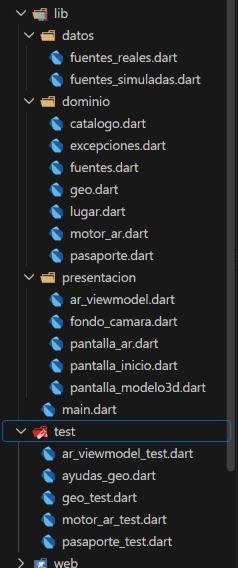
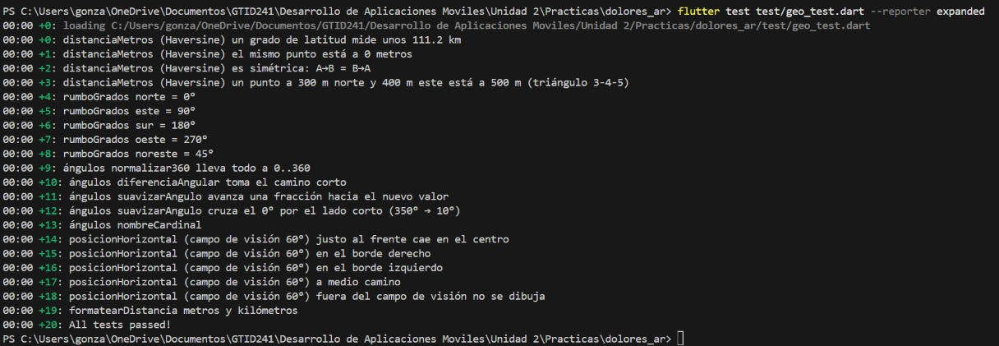
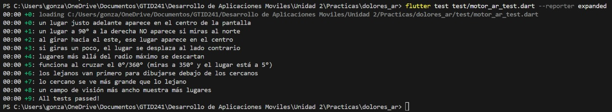
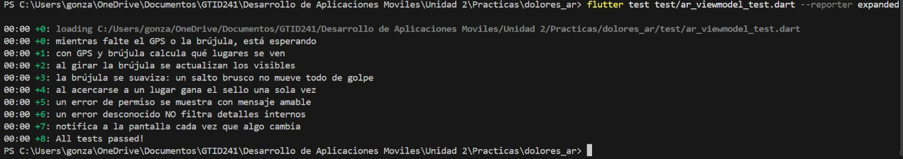
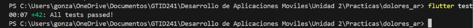
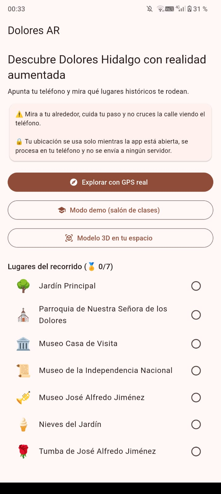
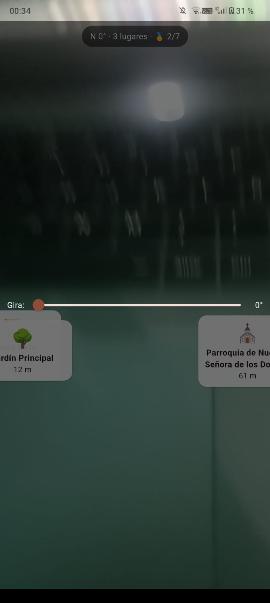
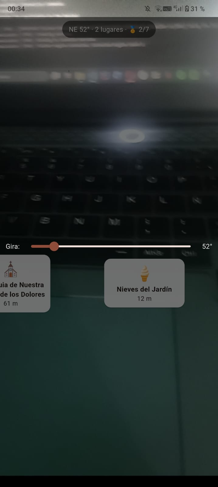
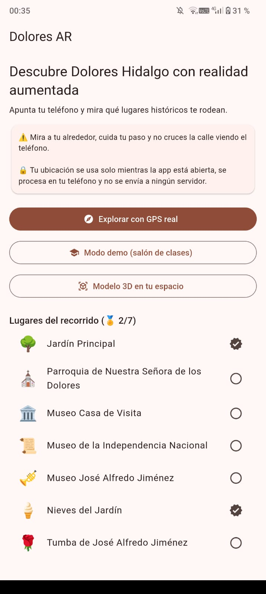

# Dolores AR · Realidad aumentada para visitar Dolores Hidalgo (TDD)

**Materia:** Desarrollo Móvil Integral
**Universidad:** UTNG, Dolores Hidalgo
**Alumno:** González López Yael Isaac
**Fecha:** 6 de Noviembre de 2026

## Descripción

App turística con dos tipos de realidad aumentada. La **RA por ubicación** usa GPS, brújula y cámara: las matemáticas (distancia de Haversine, rumbo, diferencia angular, campo de visión) deciden qué lugares se ven y en qué parte de la pantalla. La **RA de superficie** coloca un modelo 3D sobre el piso o una mesa con `model_viewer_plus`. Incluye un pasaporte turístico con sellos y un **modo demo** que funciona sin GPS gracias a que el ViewModel depende de contratos (`FuentePosicion` y `FuenteBrujula`), no de plugins.

## Estructura del proyecto

### Pruebas de geometría (`geo_test.dart`)

### Pruebas del motor y del pasaporte

### Pruebas del ViewModel

### Todas las pruebas en verde

## Evidencia de la aplicación

### Pantalla de inicio con aviso de seguridad y privacidad

### Modo demo: etiquetas flotando sobre el fondo

### Girando el deslizador cambian los lugares que se ven

### Pasaporte con palomitas en la lista de lugares

